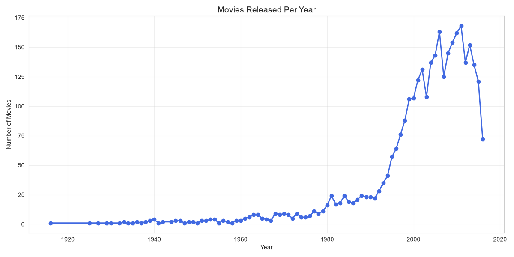

# 🎬 Movie Analytics Dashboard

An end-to-end data analytics project that transforms raw movie data from TMDB into business insights through data cleaning, exploratory data analysis, data visualization, and an interactive Streamlit dashboard.

---

## 📌 Project Overview

The movie industry generates billions of dollars every year, making performance analysis essential for studios, investors, and business analysts.

This project analyzes movie data from The Movie Database (TMDB) to answer key business questions about movie production, revenue generation, profitability, and audience ratings.

The project follows a complete analytics workflow:

**Raw Data → Data Cleaning → Exploratory Analysis → Visualization → Interactive Dashboard**

---

## 🎯 Business Questions

This project answers the following questions:

- How has movie production evolved over time?
- Which movies generated the highest revenues?
- Which movies were the most profitable?
- Which genres generate the most revenue?
- Which genres receive the highest audience ratings?

---

# 🛠️ Tech Stack

## Programming

- Python

## Data Processing

- Pandas
- NumPy

## Data Visualization

- Matplotlib
- Seaborn
- Plotly

## Dashboard

- Streamlit

## Version Control

- Git
- GitHub

---

# 📂 Project Structure

```text
movie-analytics-dashboard/
│
├── data/
│   ├── raw/
│   └── processed/
│
├── src/
│   ├── preprocess.py
│   └── analysis.py
│
├── visuals/
│
├── dashboard/
│   └── app.py
│
├── screenshots/
│   ├── movies_per_year.png
│   ├── top_movies_revenue.png
│   ├── top_profitable_movies.png
│   ├── revenue_by_genre.png
│   └── average_rating_by_genre.png
│
├── requirements.txt
│
└── README.md
```

---

# ⚙️ Data Cleaning Process

The original TMDB dataset was cleaned and transformed before analysis.

### Data Preparation Steps

✅ Removed duplicate records

✅ Removed missing values from critical columns

✅ Converted columns to appropriate data types

✅ Extracted movie release years

✅ Standardized genre information

✅ Removed unusable observations

✅ Created analytical variables

### Final Dataset

- Approximately 3,200+ cleaned movies
- 12 analytical features
- Ready for exploratory and dashboard analysis

---

# 📊 Visualization Approach

This project demonstrates two different approaches to data visualization.

## 1. Exploratory Data Analysis (EDA)

The file `analysis.py` generates static visualizations used to explore the dataset and identify business insights.

Libraries used:

- Matplotlib
- Seaborn

Generated charts are saved automatically in:

```text
visuals/
```

These visualizations help understand patterns before building the dashboard.

---

## 2. Interactive Dashboard

The file `dashboard/app.py` provides an interactive dashboard built with:

- Streamlit
- Plotly

Interactive features include:

- Dynamic filtering
- User-driven exploration
- Interactive charts
- Real-time KPI updates

This demonstrates dashboarding and business intelligence skills in addition to traditional data analysis.

---

# 📈 Key Performance Indicators (KPIs)

The dashboard includes four business KPIs:

### 🎬 Total Movies

Number of movies after data cleaning and filtering.

### 💰 Total Revenue (B$)

Total revenue generated by selected movies.

### ⭐ Average Rating

Average TMDB rating.

### 📈 Total Profit (B$)

Calculated as:

```text
Profit = Revenue − Budget
```

---

# 📊 Exploratory Data Analysis

## 🎬 Movies Released per Year

This visualization shows how movie production evolved across years.

**Insight:** Movie production increased significantly after 2000.



---

## 💰 Top 10 Movies by Revenue

Displays the highest-grossing movies in the dataset.

**Insight:** A small number of blockbuster movies account for a large portion of total revenue.


---

## 📈 Top 10 Most Profitable Movies

Displays movies with the highest profits.

**Formula:**

```text
Profit = Revenue − Budget
```

**Insight:** The highest revenue movie is not always the most profitable.


---

## 🎭 Revenue by Genre

Compares total revenue generated by genres.

**Insight:** Action, Adventure, and Animation dominate global revenue.


---

## ⭐ Average Rating by Genre

Displays audience ratings by genre.

**Insight:** Some genres achieve stronger audience satisfaction despite generating lower revenues.


---

# 💡 Key Insights

### Movie Production Growth

Movie releases increased considerably during the last two decades.

### Revenue Concentration

A limited number of blockbuster productions generate most of the industry's revenue.

### Profitability Matters More Than Revenue

Some medium-budget movies outperform high-budget productions in profitability.

### Genre Differences

Revenue and ratings vary significantly across genres.

### Business Perspective

Studying profitability, revenue, and ratings together provides a more complete view of movie performance than any single metric alone.

---

# 🚀 Installation

Clone the repository:

```bash
git clone https://github.com/Alpha38diallo/movie-analytics-dashboard.git
```

Move into the project folder:

```bash
cd movie-analytics-dashboard
```

Create a virtual environment:

```bash
python -m venv venv
```

Activate the environment.

### macOS / Linux

```bash
source venv/bin/activate
```

### Windows

```bash
venv\Scripts\activate
```

Install dependencies:

```bash
pip install -r requirements.txt
```

---

# ▶️ Run Data Processing

Generate the cleaned dataset:

```bash
python src/preprocess.py
```

---

# ▶️ Generate Visualizations

Create exploratory analysis charts:

```bash
python src/analysis.py
```

Charts are automatically saved inside:

```text
visuals/
```

---

# ▶️ Launch the Dashboard

Run Streamlit:

```bash
streamlit run dashboard/app.py
```

The dashboard will open automatically in your web browser.

---

# 🎯 Skills Demonstrated

This project showcases:

- Data Cleaning
- Data Transformation
- Exploratory Data Analysis (EDA)
- Business Analytics
- Data Visualization
- Dashboard Development
- Interactive Reporting
- Python Programming
- Git & GitHub
- Data Storytelling

---

# 📚 Data Source

### The Movie Database (TMDB)

https://www.themoviedb.org/

This project uses TMDB movie metadata for educational and portfolio purposes.

---

# 🔮 Future Improvements

Possible future enhancements:

- Advanced filtering options
- Revenue forecasting models
- Machine learning predictions
- Actor analysis
- Director analysis
- Production company analysis
- Genre recommendation engine
- Cloud deployment automation

---

# 👨‍💻 Author

## Alpha Diallo

Aspiring Data Engineer & Data Analyst

GitHub:
https://github.com/Alpha38diallo

---

# 📄 License

This project is intended for educational, learning, and portfolio purposes.