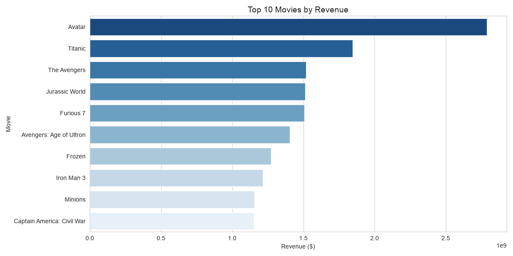
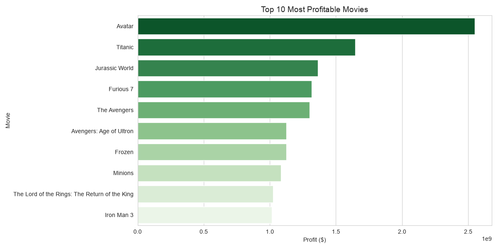
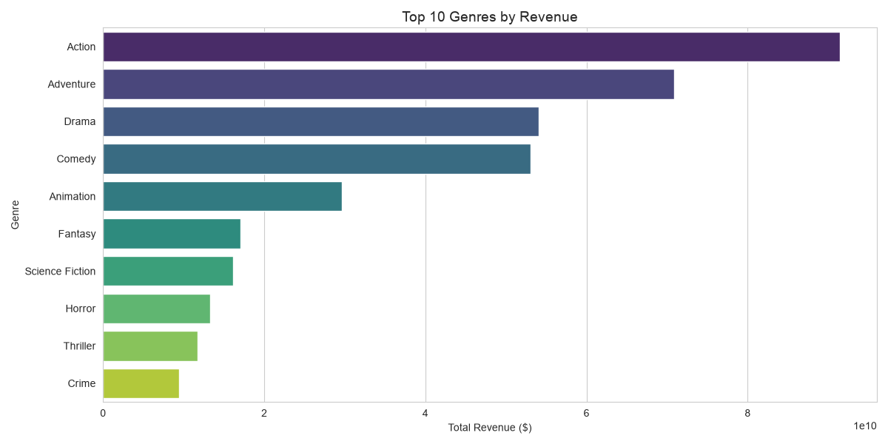
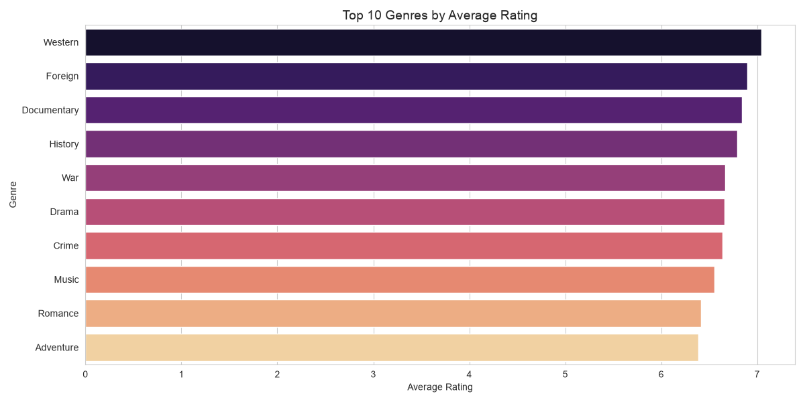

# 🎬 Movie Analytics Dashboard

An interactive data analytics dashboard built with Python and Streamlit to explore trends, profitability, ratings, and revenue performance across thousands of movies from The Movie Database (TMDB).


---

## 📌 Project Overview

The entertainment industry generates billions of dollars every year, making movie performance analysis an important business activity for studios, investors, and analysts.

This project transforms raw TMDB movie data into actionable insights through data cleaning, exploratory data analysis, and interactive visualizations.

The dashboard enables users to:

- Analyze movie industry trends over time
- Identify top-performing movies
- Explore profitability patterns
- Compare genre performance
- Evaluate audience ratings
- Interact with filters for deeper analysis

---

## 🎯 Business Questions

This project answers questions such as:

- How has movie production evolved over the years?
- Which movies generated the highest revenues?
- Which movies were the most profitable?
- Which genres generate the most revenue?
- Which genres receive the best audience ratings?

---

## 🚀 Features

### 📊 Key Performance Indicators (KPIs)

The dashboard includes four business metrics:

✅ Total Movies

✅ Total Revenue (B$)

✅ Average Rating

✅ Total Profit (B$)

---

## 📈 Dashboard Visualizations

### 🎬 1. Movies Released per Year

Tracks movie production trends over time and highlights the growth of the film industry.


---

### 💰 2. Top 10 Movies by Revenue

Identifies the highest-grossing movies in the dataset.



---

### 📈 3. Top 10 Most Profitable Movies

Displays movies that generated the highest profit:

**Profit = Revenue − Budget**



---

### 🎭 4. Revenue by Genre

Compares the total revenue generated by each movie genre.



---

### ⭐ 5. Average Rating by Genre

Shows which genres receive the highest audience ratings.



---

## 📊 Key Insights

### Movie Production Growth

Movie production has significantly increased since the early 2000s, reflecting the expansion of the global entertainment industry.

### Revenue Concentration

A small number of blockbuster movies generate a disproportionately large share of total revenue.

### Profitability vs Revenue

High revenue does not always mean high profitability. Some movies achieve exceptional returns despite moderate budgets.

### Genre Performance

Action, Adventure, and Animation genres dominate worldwide box office earnings.

### Audience Preferences

Certain genres consistently achieve higher audience ratings, indicating stronger viewer satisfaction.

---

## 🛠️ Technologies Used

| Category | Tools |
|-----------|--------|
| Programming | Python |
| Data Processing | Pandas, NumPy |
| Visualization | Plotly, Matplotlib, Seaborn |
| Dashboard | Streamlit |
| Version Control | Git, GitHub |

---

## 📂 Project Structure

```text
movie-analytics-dashboard/
│
├── data/
│   ├── raw/
│   └── processed/
│
├── src/
│   ├── preprocess.py
│   └── analysis.py
│
├── visuals/
│
├── dashboard/
│   └── app.py
│
├── screenshots/
│   ├── movies_per_year.png
│   ├── top_movies_revenue.png
│   ├── top_profitable_movies.png
│   ├── revenue_by_genre.png
│   └── average_rating_by_genre.png
│
├── requirements.txt
│
└── README.md
```

---

## ⚙️ Data Cleaning Process

Before analysis, the original TMDB dataset underwent several cleaning and preprocessing steps:

- Removed duplicate records
- Removed rows with critical missing values
- Converted data types
- Extracted movie release years
- Filtered unrealistic values
- Standardized genre information
- Removed unusable observations

### Final Dataset

- Approximately **3,200+ cleaned movies**
- 12 analytical features
- Optimized for visualization and exploratory analysis

---

## ▶️ Installation

### Clone the Repository

```bash
git clone https://github.com/yourusername/movie-analytics-dashboard.git
```

### Navigate to the Project Directory

```bash
cd movie-analytics-dashboard
```

### Create a Virtual Environment

```bash
python -m venv venv
```

### Activate the Environment

#### macOS / Linux

```bash
source venv/bin/activate
```

#### Windows

```bash
venv\Scripts\activate
```

### Install Dependencies

```bash
pip install -r requirements.txt
```

---

## ▶️ Run the Data Pipeline

### Data Cleaning

```bash
python src/preprocess.py
```

### Generate Visualizations

```bash
python src/analysis.py
```

---

## ▶️ Launch the Dashboard

```bash
streamlit run dashboard/app.py
```

The application will open automatically in your browser.

---

## 🌐 Future Improvements

Potential enhancements include:

- Advanced filtering options
- Revenue forecasting models
- Machine learning recommendations
- Actor and director analysis
- Interactive Plotly charts
- Cloud deployment automation

---

## 📚 Data Source

**The Movie Database (TMDB)**

https://www.themoviedb.org/

---

## 📝 Notes

Dataset preparation included:

- Duplicate removal
- Missing value treatment
- Type conversion
- Genre extraction
- Outlier filtering

All results presented in the dashboard were generated using the cleaned dataset.

---

## 👨‍💻 Author

### Alpha Diallo

Aspiring Data Engineer & Data Analyst

GitHub: https://github.com/yourusername

LinkedIn: https://linkedin.com/in/yourprofile

---

## ⭐ Project Status

✅ Completed

✅ Ready for Portfolio

✅ Ready for GitHub

✅ Ready for Deployment

---

## 📄 License

This project is intended for educational, analytical, and portfolio purposes.